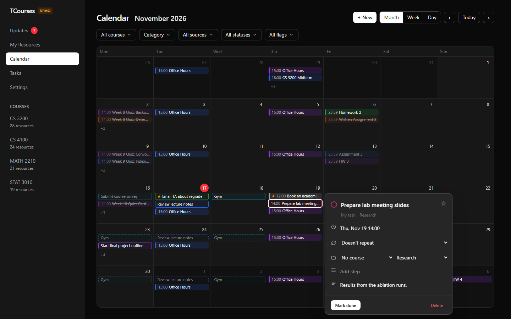
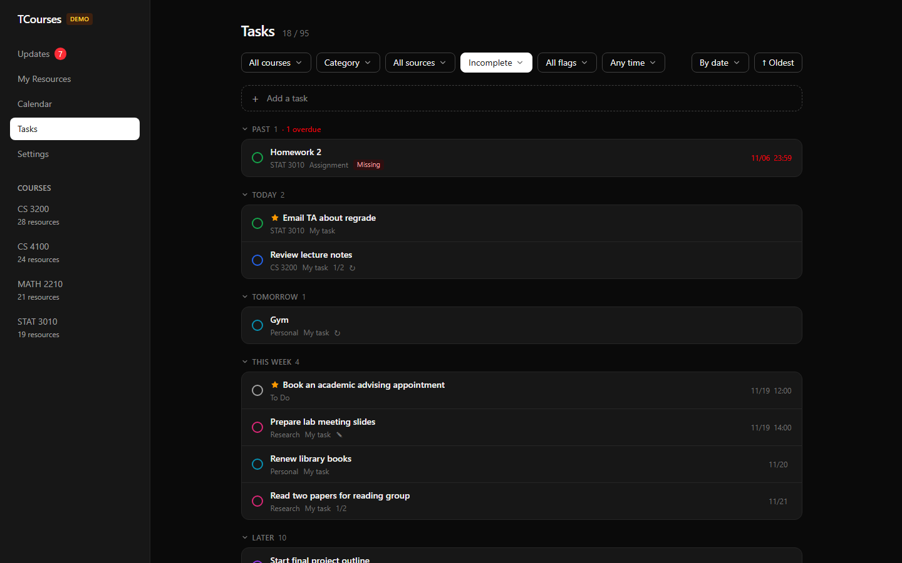
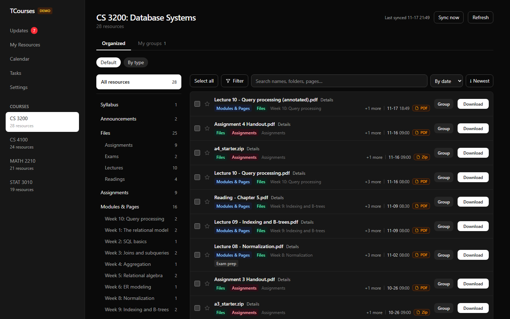
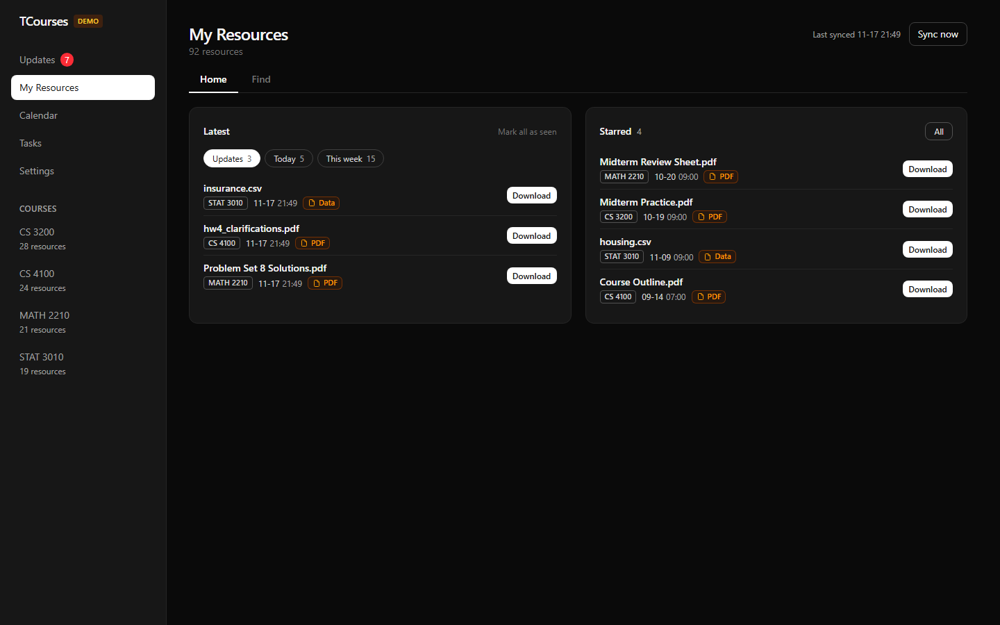
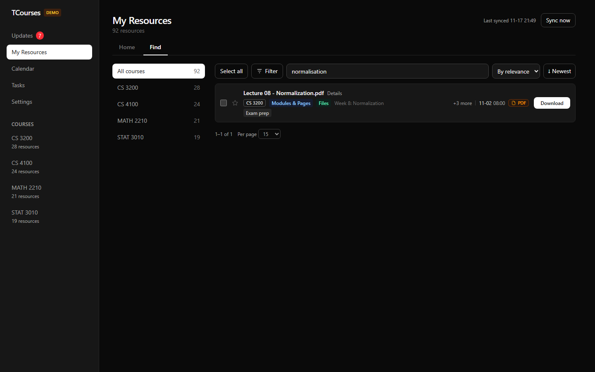
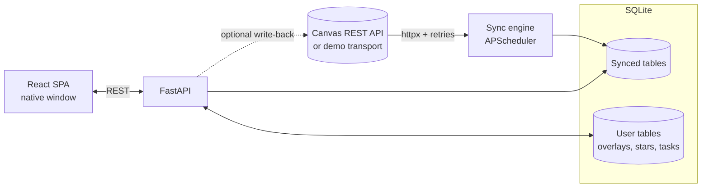

# TCourses

A local-first desktop companion for [Canvas LMS](https://www.instructure.com/canvas): every course resource in one searchable library, and every deadline in one calendar.

[](https://github.com/jasonliujc/tcourses/actions/workflows/ci.yml)
[](LICENSE)




Canvas scatters course material across Files, Modules, Pages, Assignments, Quizzes, Announcements and the Syllabus, and many institutions disable the Files tab entirely. Deadlines are spread across courses and views. TCourses syncs all of it through the Canvas REST API into a local SQLite database, then gives it back as one resource library, one calendar and one task list. It runs on your own machine, so your token and your data stay there.

## Features

**Resource library**
- Collects files *and* external links from every place Canvas can hold them (Files, Modules, Pages, Assignments, Quizzes, Announcements, Syllabus, and optionally Discussions), deduplicated, with a record of where each one appeared
- Typed groups that always partition a course: group counts add up to the total
- Fuzzy search that tolerates punctuation, case and typos, matches file names, page titles, folder paths, module names and URLs, and shows where each hit matched
- "What's new" per course with a seen watermark, plus today / this week views
- Stars and personal groups; bulk ZIP download, including across courses

**Calendar and tasks**
- Syncs the Canvas Planner: assignments, quizzes, discussions, events and to-dos, with submission state
- Month / week / day calendar and a filterable task list grouped by date, course, category or list
- Local edits (title, time, location, notes, flags) live in an overlay that sync never overwrites
- Your own tasks with due dates or times, steps, notes, lists and recurrence
- Optional write-back of completion state to Canvas (off by default)

**General**
- Desktop app for Windows and macOS, plus a demo mode with a generated sample semester
- English and Chinese UI, time-zone aware
- Choose which courses to sync, what to collect, and how often

**Under development**
- Dashboard overview
- Deadlines and notifications
- AI file management
- AI assistance (e.g. for review)

| | |
|---|---|
|  |  |
|  |  |

## Download

Get the latest build from [Releases](https://github.com/jasonliujc/tcourses/releases/latest), unzip it, and run:

- **TCourses**: the app. Open **Settings**, enter your Canvas URL and an access token, and save. You can create a token in Canvas under **Account → Settings → Approved Integrations → New Access Token**.
- **TCourses Demo**: the same app with a generated sample semester. No account or network needed, and nothing is kept after you close it.

On macOS, run `TCourses Demo.command` for the demo. The builds are not code-signed: on Windows choose *More info → Run anyway*, on macOS right-click the app and choose *Open*. Your data lives in `%LOCALAPPDATA%\TCourses` (Windows) or `~/Library/Application Support/TCourses` (macOS).

## How it works

- **Sync engine.** Courses sync concurrently with bounded parallelism over an async HTTP client. Transient failures retry with exponential backoff. Change detection uses content hashes and per-resource watermarks. Re-checks are prioritized by activity, with a hard bound on how stale any record can get. Endpoints an institution has disabled (HTTP 403) are remembered and retried later instead of every round. The next run is scheduled from the end of the previous one, so slow syncs never pile up.
- **Discovery before collection.** Each course is asked which navigation sections it exposes. Anything the collector cannot cover is reported, not silently skipped.
- **Synced data vs. user data.** Synced tables are rebuilt from Canvas, and user state lives in separate tables keyed by stable Canvas identities rather than row ids. Edits are stored per field, so an upstream change to an untouched field still comes through. Items you edited are kept and flagged if they are deleted upstream. Completion is tri-state: follow Canvas, or a local value that sync will not override.
- **Time.** Timestamps are stored in UTC. All-day events are placed by calendar date so they don't drift across time zones. Recurrence uses RFC 5545 rules (`dateutil.rrule`) evaluated in each task's own time zone, so a weekly 9:00 task stays at 9:00 across DST. Future occurrences are projected at read time, not stored.
- **Demo mode as a simulated API.** The demo replaces the Canvas server, not the app: an `httpx` transport answers the Canvas REST endpoints with a generated semester. The real client and sync pipeline run unchanged, two sync passes ("a few days ago", then "today") produce genuine updates, and downloads return real files.
- **One process, one window.** FastAPI serves the built frontend next to the API. A launcher picks a per-user data directory, keeps a single instance per directory, and opens a native window through the system WebView; PyInstaller bundles it into a standalone app.
- **SQLite under concurrency.** WAL journaling, a busy timeout, and short write transactions keep concurrent course syncs from blocking each other.
- **Language-neutral API.** The API returns result and error codes with data, never prose. The UI owns every user-facing string.
- **Tests.** 300+ pytest cases run against fake and simulated Canvas clients, in CI on every push. The frontend is fully type-checked.

## Architecture



| Layer | Stack |
|---|---|
| Backend | Python 3.11+, FastAPI, SQLAlchemy 2.0 (async) + aiosqlite, Pydantic v2, APScheduler, httpx, tenacity, python-dateutil |
| Frontend | React 18, TypeScript, Vite, Tailwind CSS v4, TanStack Query, React Router |
| Desktop | pywebview, PyInstaller |
| Storage | SQLite (WAL), local file store for downloaded attachments |
| Tooling | pytest, pytest-asyncio, ruff, tsc, GitHub Actions |

```
backend/
  app/
    api/v1/          REST endpoints
    integrations/    Canvas client, response mapping, sync service
    services/        collection, search, planner, tasks, bundling, purge
    models/          SQLAlchemy models
    workers/         scheduler
    demo/            generated semester + simulated Canvas transport
    desktop.py       desktop launcher
  tests/
frontend/
  src/
    pages/           Calendar, Tasks, Resources, Course files, Settings
    components/      shared UI (cards, filters, popovers, file list)
    api/             typed hooks over the REST API
packaging/           PyInstaller spec and build script
```

## Running from source

**Prerequisites:** Python 3.11+ and Node.js 20+.

```bash
git clone https://github.com/jasonliujc/tcourses.git
cd tcourses
cd backend && python -m venv .venv
source .venv/bin/activate          # Windows: .venv\Scripts\activate
pip install -e ".[dev,desktop]"
cd ../frontend && npm install && npm run build
cd ../backend
python -m app.desktop              # the app
python -m app.desktop --demo       # the demo
```

For development with hot reload, run the backend and the Vite dev server separately and open <http://localhost:5173>:

```bash
cd backend && uvicorn app.main:app --reload --port 8000
cd frontend && npm run dev
```

To build the desktop package for your platform:

```bash
python packaging/build.py          # writes dist/TCourses-<version>-<platform>.zip
```

## Configuration

Everything a user normally changes, including the Canvas connection, is in the Settings page. For development, startup defaults can be set in `backend/.env` (copy `backend/.env.example`):

| Variable | Default | Purpose |
|---|---|---|
| `DATABASE_URL` | `sqlite+aiosqlite:///./tcourses.db` | Database location |
| `STORAGE_ROOT` | `../storage` | Where downloaded attachments are stored |
| `SYNC_INTERVAL_MINUTES` | `15` | Initial auto-sync interval |
| `SYNC_ON_STARTUP` | `true` | Run a sync when the server starts |
| `MAX_DOWNLOAD_MB` | `100` | Per-file download limit |

## Development

```bash
cd backend && pytest && ruff check app tests
cd frontend && npm run lint
```

Interactive API docs are served at `/docs` while the backend is running.

## Privacy and security

- Everything runs locally. The app talks only to the Canvas instance you configure.
- The access token is stored in the local database and is never returned by the API (only its last four characters are shown).
- Read-only by default. The only write to Canvas is the optional completion write-back.

## About

TCourses is designed and developed by Jason Liu. I determined the product features and logic, the full-stack system architecture and the technical approach, and implemented it with an AI coding agent. I reviewed and tested all changes against a live Canvas account.

## License

[MIT](LICENSE)

TCourses is not affiliated with or endorsed by Instructure. Canvas is a trademark of Instructure, Inc.
